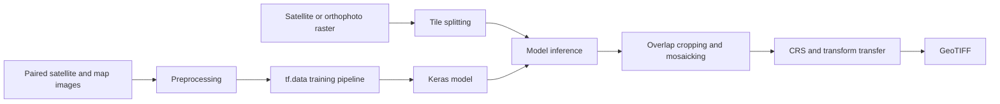

# Map Generation from Satellite Imagery

> **Article:** A. E. Arık and N. Emrahoğlu, *Learned versus Classical Structural Representations for GNSS-Denied UAV Localization by Template Matching: A Cross-Source Map Benchmark and Flight Replay*, submitted to the *International Journal of Engineering and Geosciences* (IJEG), 2026. To cite this code, see [CITATION.cff](CITATION.cff).

Academic research software developed for autoencoder-based image-to-image translation, large raster processing with tiling, and GeoTIFF output generation.

> **Project status:** Research prototype. The code supports the data preparation, model training, and inference workflow; however, this repository does not include a published dataset, trained model weights, or a final benchmark table.

**Quick access:** [Method](#method-and-workflow) · [Installation](#installation) · [Usage](#usage) · [Outputs](#output-structure) · [Reproducibility](#experimental-design-and-reproducibility) · [Evaluation](#evaluation) · [Citation](#citation)

## Abstract

This project investigates supervised deep learning approaches to translate satellite or orthophoto imagery into cartographic rasters or object masks. The large input raster is first divided into overlapping tiles. The tiles are processed with a trained Keras model, reconstructed into a single lossless mosaic, and saved as a GeoTIFF if a suitable spatial reference is available.

The current implementation of the study consists of four components:

1. Preparation of training data or masks from side-by-side paired images.
2. Training of configurable autoencoder/U-Net variants.
3. Tile-based batch inference and mosaicking on large rasters.
4. Transfer of CRS and transformation information from a source or reference raster.

**Keywords:** remote sensing, satellite imagery, image-to-image translation, autoencoder, U-Net, cartographic generalization, GeoTIFF.

### Turkish abstract (Türkçe Özet)

Bu araştırma yazılımı, uydu veya ortofoto görüntülerini kartografik rasterlara ya da nesne maskelerine dönüştürmek için denetimli görüntü-görüntü dönüşümü yaklaşımlarını inceler. Büyük rasterlar örtüşen karolara ayrılır, eğitilmiş bir Keras modeliyle işlenir, kayıpsız bir mozaik olarak yeniden birleştirilir ve geçerli bir mekânsal referans varsa GeoTIFF olarak kaydedilir. Depo; veri hazırlama, eğitim, çıkarım, mozaikleme ve jeoreferanslama kodlarını sağlar. Şu anda bir veri kümesi, eğitilmiş ağırlıklar veya hakem denetiminden geçmiş test sonuçları dağıtmamaktadır.

## Research Objective

The main research question is to what extent spatial patterns in high-resolution satellite/orthophoto data can be translated into a pixel-level cartographic representation. The repository is designed to support the following experiments:

- grayscale, RGB, or different input/output channel combinations;
- comparison of standard autoencoders with residual U-Net variants;
- L1, SSIM, and weighted hybrid loss functions;
- filtering of empty or uninformative target tiles;
- different tile overlap, normalization, and image enhancement settings;
- lossless mosaicking of model output and preservation of spatial reference.

The code is not fixed to a specific region. However, the automatic reference matching dictionary currently includes some place names used around Cappadocia. For new study areas, the `CONFIG["reference"]["auto_match_keywords"]` list should be expanded or the reference raster should be explicitly specified.

## Method and Workflow



### 1. Data preparation

Training samples must be paired horizontally within a single image:

```text
+----------------------+----------------------+
| left: satellite/ortho| right: target map    |
+----------------------+----------------------+
```

`egitim/harita_maske_onisleme.py` can generate a black object mask from the map information on the right half. The `paired` mode saves the satellite and mask side-by-side again; the `mask` mode only saves the mask. Default settings can also generate repeatable (`seed=42`) light, color, shadow, noise, and blur variations on the satellite side.

### 2. Training

`egitim/autoencoder_unified.py` splits the paired image in half at runtime, normalizes the input and target to the `[-1, 1]` range, and feeds them to the model via a `tf.data` pipeline. Main values among current defaults:

| Setting | Default value |
|---|---:|
| Image size | `544 x 544` |
| Input mode | `grayscale` |
| Output mode | `grayscale` |
| Model | `classic` |
| Output activation | `tanh` |
| Train/validation split | `0.90 / 0.10` |
| Random seed | `42` |
| Batch size | `8` |
| Epochs | `20` |
| Optimizer | Adam, `1e-3` |
| Loss | `weighted_hybrid` |

The training configuration is managed from the `Config` class at the beginning of the file rather than a CLI. Supported model options are `unet_residual`, `autoencoder`, `autoencoder_backup`, `upsampled`, `advanced`, `gpt`, `gpt_no_reg`, `deneysel`, `classic`, and `flat_bottleneck`. Code comments describe `flat_bottleneck` as the shallow architecture class that reached `success_25m = 0.70` in an internal benchmark; this figure has not been independently reproduced or documented in this repository and should be re-verified before being cited.

`OUTPUT_ACTIVATION` (`tanh` or `sigmoid`) fixes the value range training labels must be normalized to: `tanh` expects labels in `[-1, 1]`, `sigmoid` expects `[0, 1]`. `validate_activation_contract()` fails fast if the activation and the label range disagree, but this is a training-time check only — the corresponding input normalization for inference must still be set manually (see [Tile-based inference](#3-tile-based-inference)).

#### Channel strategies

Input and target channel numbers can be set independently:

| `COLOR_MODE` | `OUTPUT_COLOR_MODE` | Usage |
|---|---|---|
| `grayscale` | `grayscale` | Single-channel satellite image to single-channel map/mask |
| `rgb` | `rgb` | Color satellite image to color cartographic raster |
| `rgb` | `grayscale` | Color satellite image to single-channel map/mask |
| any | `auto` | Keep output channels the same as input channels |

When the channel strategy is changed, the input/output shape of the model, training data, and inference setting must be changed together. A channel or normalization mismatch between training and inference can produce meaningless output even if the model file loads successfully.

#### Objective function

The default `weighted_hybrid` loss combines weighted absolute error with structural similarity loss:

```text
L = 0.8 * [sum_i(w_i * |y_i - y_hat_i|) / sum_i(w_i)]
    + 0.2 * [1 - SSIM(y, y_hat)]
```

Default pixel weights are `1` for the light background, `2` for non-white content, and `8` for dark details. The goal is to increase the impact of dark details such as roads, borders, and buildings in targets dominated by a light background. These weights are not learned from the dataset; they should be reported as experimental hyperparameters and tested via ablation.

### 3. Tile-based inference

Current defaults use `tile_size=544`, `overlap=32`, and thus `frame_size=512`. During merging, `crop_overlap=16` pixels are cropped from each edge. Basic consistency conditions:

```text
frame_size = tile_size - overlap
crop_overlap = overlap / 2
tile_size = spatial input size expected by the model
```

Tiles are saved as PNG. The model channel in `auto` mode is determined by looking at the input shape of the model. Inference normalization must be the same as the normalization used by the model during training; the default for models trained in this project is the `minus1_1` option.

Main inference options:

| Parameter | Options | Description |
|---|---|---|
| `color_mode` | `auto`, `grayscale`, `rgb` | Determines the model input channel |
| Normalization | `minus1_1`, `zero_1`, `raw`, `zscore` | Maps input value range with training |
| Enhancement | `none`, `hist_eq`, `clahe` | Applies contrast processing before normalization |
| `batch_size` | positive integer | Balances speed and GPU/RAM consumption |
| Tile format | PNG | Prevents lossy compression in intermediate output |

All normalization and image enhancement options are available in the programmatic API and graphical interface. The CLI uses the default `auto` value for `color_mode`; if an explicit choice is to be made via the CLI, the available options are limited to `grayscale` and `rgb`.

### 4. Georeferencing

The pipeline determines spatial information with the following priority order:

1. Reference GeoTIFF provided by the user.
2. Safely matched reference raster by file name.
3. The input GeoTIFF's own CRS and transform information if it is georeferenced.

If none of these sources exist, a mosaic is produced, but georeferencing is skipped. When a separate reference is used, raster extent, pixel size, CRS, and data alignment must be verified by the user.

## Repository Structure

```text
autoencoder_sat_to_map/
|-- src/
|   |-- goruntu_islemleri.py       # CLI and core processing class
|   `-- harita_uretici_arayuz.py   # Gradio interface
|-- egitim/
|   |-- autoencoder_unified.py     # Current training implementation
|   |-- harita_maske_onisleme.py   # Mask and paired data generation
|   `-- autoencoder_...py          # Previously active training variants
|-- arsiv/                         # Historical experiments; not mainline
|-- ciktilar/                      # Pipeline working directories
|-- ana_haritalar/                 # Old/manual mosaic outputs
|-- georefli/                      # Old/manual GeoTIFF outputs
`-- README.md
```

Scripts under `arsiv/` are kept to preserve the experiment history. For new work, `src/goruntu_islemleri.py`, `src/harita_uretici_arayuz.py`, and `egitim/autoencoder_unified.py` should be the basis.

## Installation

### Requirements

- Python 3.10 recommended.
- TensorFlow 2.x for model training/inference.
- Rasterio and GDAL-compatible system libraries for GeoTIFF operations.
- If using a GPU, TensorFlow, CUDA, cuDNN, and the graphics card driver must be compatible with each other.

Since there is no pinned `requirements.txt` or `environment.yml` in the repository yet, the installation below is a starting environment; exact package versions should be recorded separately in published experiments.

```powershell
conda create -n sat2map python=3.10 -y
conda activate sat2map
conda install -c conda-forge numpy opencv matplotlib natsort tqdm rasterio affine -y
pip install tensorflow gradio
```

If the histogram equalization training mode is used, a `tensorflow-addons` installation compatible with the TensorFlow version is also required:

```powershell
pip install tensorflow-addons
```

To save the installation:

```powershell
python --version
python -m pip freeze > environment-lock.txt
```

`environment-lock.txt` is a local experiment record; it may not be automatically added to the repository due to the current `.gitignore` structure.

## Usage

All commands must be run from the repository root directory.

### Graphical Interface

```powershell
python src/harita_uretici_arayuz.py
```

The interface allows the selection of input raster, model, reference raster, tile size, overlap, normalization, image enhancement (histogram equalization or CLAHE), and batch size. The run log and generated mosaic and GeoTIFF files can be monitored from the same interface.

### Full Pipeline with a Single Model

```powershell
python src/goruntu_islemleri.py pipeline `
  --input "veri/girdi.tif" `
  --model_dir "modeller/tek_model" `
  --reference "veri/girdi.tif" `
  --run_name "deney_001"
```

In this example, the `modeller/tek_model/` directory should only contain the `.h5` or `.keras` file to be run. If there is a valid `--model_dir`, the application processes this directory before the `--model_path` option. If `--reference` is not provided, automatic reference selection and then the input GeoTIFF's own spatial information are tried.

### Inference with All Models in a Directory

```powershell
python src/goruntu_islemleri.py pipeline `
  --input "veri/girdi.tif" `
  --model_dir "modeller" `
  --output_root "ciktilar" `
  --batch_size 8
```

### Running Steps Separately

```powershell
# Tile generation
python src/goruntu_islemleri.py split `
  --input "veri/girdi.tif" `
  --output_dir "calisma/karolar" `
  --tile_size 544 `
  --overlap 32 `
  --format png `
  --save_metadata

# Mosaicking with metadata
python src/goruntu_islemleri.py merge `
  --input_dir "calisma/karolar" `
  --output "calisma/mozaik.png"

# Converting mosaic to GeoTIFF
python src/goruntu_islemleri.py georef `
  --input "calisma/mozaik.png" `
  --reference "veri/referans.tif" `
  --output "calisma/mozaik_geo.tif" `
  --compress LZW
```

All CLI options:

```powershell
python src/goruntu_islemleri.py --help
python src/goruntu_islemleri.py split --help
python src/goruntu_islemleri.py pipeline --help
python src/goruntu_islemleri.py merge --help
python src/goruntu_islemleri.py georef --help
```

### Mask and Paired Training Data Generation

```powershell
python egitim/harita_maske_onisleme.py `
  --input_dir "ham_veri" `
  --output_dir "training_set" `
  --mode paired `
  --mask_profile balanced `
  --save_preview 10
```

The `strict` profile uses stricter morphological thresholds aiming for a lower false-positive rate. This preprocessing is based on classic image processing thresholds; visual inspection and parameter calibration are required for different map styles and color palettes.

### Model Training

1. Adjust `Config.DATA_DIR`, channel mode, model, loss function, and training hyperparameters in `egitim/autoencoder_unified.py` according to the experiment protocol.
2. Verify that paired images contain the input on the left half and the target on the right half.
3. Start training:

```powershell
python egitim/autoencoder_unified.py
```

A checkpoint is generated for each epoch and `son_model.h5` at the end of training. To resume an existing model, `Config.PRETRAINED_MODEL` must be explicitly set.

## Minimal Reproducible Experiment

To make an experiment not only runnable but also verifiable later, the following minimal recording flow is recommended:

```powershell
# 1. Save code version
git rev-parse HEAD

# 2. Save environment
python --version
python -m pip freeze > environment-lock.txt

# 3. Run inference with a unique name
python src/goruntu_islemleri.py pipeline `
  --input "veri/test_bolge_01.tif" `
  --model_dir "modeller/deney_001" `
  --reference "veri/test_bolge_01.tif" `
  --run_name "deney_001_test_bolge_01"
```

After the run is complete, the following checks should be made:

1. Are the input, model, and output paths in `run_manifest.json` correct?
2. Are there any errors, skipped tiles, or failed models in `pipeline.log`?
3. Is the tile count in `metadata.json` equal to the model output count?
4. Are there any gaps, repetitions, or seam artifacts in the mosaic?
5. Do the GeoTIFF CRS, bounds, and pixel size match the source raster?
6. Was the quantitative evaluation calculated only on a previously unseen geographical test area?

### Common Issues

| Symptom | Check/solution |
|---|---|
| Rasterio or GDAL installation fails | Use `conda-forge` packages in the same environment; do not mix `pip` and Conda GDAL installations haphazardly. |
| Model cannot be loaded | Check TensorFlow/Keras version, HDF5 support for `.h5`, and custom loss functions. The pipeline includes a compatibility layer for some older `Conv2DTranspose` configurations. |
| Output is completely light, dark, or corrupted | Compare channel mode, `tile_size`, normalization, and output activation in training with inference settings. |
| Colors look inverted | Verify that OpenCV uses BGR and the model pipeline uses RGB; check any custom preprocessing code inserted. |
| Tile merge is shifted or seamed | Keep the `metadata.json` file and verify the `crop_overlap = overlap / 2` condition. |
| GPU memory insufficient | First lower `batch_size`; rerun without reducing scientific scope or tile samples. |
| GeoTIFF in wrong location | Independently verify that the reference raster belongs to the correct region, CRS, extent, and resolution. |

## Output Structure

The default full pipeline creates a timestamped working directory to avoid overwriting previous results:

```text
ciktilar/<input_name>/run_YYYYMMDD_HHMMSS/
|-- 01_crops/
|   |-- goruntu_<row>_<col>.png
|   `-- metadata.json
|-- 02_model/<model_name>/
|   |-- goruntu_<row>_<col>.png
|   `-- metadata.json
|-- 03_merged/
|   `-- ana_harita_<input>_<model>.png
|-- 04_georef/
|   `-- ana_harita_<input>_<model>_geo.tif
|-- pipeline.log
`-- run_manifest.json
```

`metadata.json` records tile grid information; `pipeline.log` the process log; and `run_manifest.json` the input, model, reference, and generated file paths. In academic archiving, these three files should be preserved along with model weights and environment dumps.

## Experimental Design and Reproducibility

For a publishable experiment, at least the following information should be reported:

- repository commit ID (`git rev-parse HEAD`) and Python/package versions;
- data source, license, date range, geographical extent, and ground sampling distance;
- file lists of training, validation, and test areas;
- model type, input/output channels, normalization, loss, and all hyperparameters;
- `tile_size`, `overlap`, `crop_overlap`, batch size, and inference hardware;
- CRS and transform of the reference raster, and spatial extent check of the output;
- random seeds, checkpoint selection criteria, and stopping rule;
- quantitative metrics and qualitative error examples.

Current training code files shuffle with `seed=42` and randomly split 90/10. Since neighboring tiles come from the same scene, this method can lead to spatial data leakage and optimistic validation results. In final experiments, training, validation, and test sets should not be created file by file, but based on disjoint geographical blocks or regions.

For TensorFlow, setting only the NumPy seed does not guarantee a fully deterministic run. If exact reproduction is required, Python, NumPy, and TensorFlow seeds must be pinned together, appropriate deterministic operation options must be enabled, and GPU/software versions must be reported.

## Evaluation

There is currently no automated testing or benchmark module in the repository. Therefore, the README does not claim that any model is scientifically better or achieves a specific level of success.

Recommended reporting set based on purpose:

| Output type | Quantitative metrics | Additional check |
|---|---|---|
| Continuous/cartographic raster | MAE, RMSE, SSIM, PSNR | Edge and thin line preservation |
| Binary object mask | Precision, recall, F1, IoU | Error by object size |
| Georeferenced result | location error in meters | CRS, extent, and pixel size |
| System performance | tiles/s, total time, peak memory | CPU/GPU and batch info |

Metrics should be given per scene/region in addition to the image average; distribution, confidence interval, and outliers should be reported along with central tendency.

### Result table template

When adding results to the README or supplementary material of a paper, empty or unverified cells should not be filled with success claims. The following structure allows models to be compared under the same test protocol:

| Experiment | Training regions | Test region | Model | In/Out | SSIM or IoU | MAE or F1 | Time (s) | Note |
|---|---|---|---|---|---:|---:|---:|---|
| `exp_001` | `<regions>` | `<disjoint region>` | `<model>` | `1→1` | `<value>` | `<value>` | `<value>` | `<hardware>` |

Along with each table, the number of test samples, metric direction, calculation scale, checkpoint selection rule, and the commit ID used should be provided.

## Known Limitations

- The dataset and trained models are not included in this repository; they must be obtained separately.
- Dependency versions are not yet pinned.
- Training configuration is inside a Python class rather than a CLI or experiment YAML.
- The default train/validation split is not spatially blocked.
- Automatic reference selection relies on filename keywords.
- Georeferencing does not automatically measure semantic or geometric registration error.
- Stopping from the interface cancels the running task; completeness of partial outputs must be verified separately.
- Unit and integration tests for the research code have not been added yet.

## Data, Ethics, and Terms of Use

Satellite, orthophoto, and online map data may be subject to different copyright, licensing, attribution, and redistribution conditions. The user is responsible for reviewing the data provider's terms; verifying the right to share training and derived outputs; and taking appropriate measures if there is a risk involving sensitive locations or personal data.

The generated maps should not be used in navigation, disaster management, cadastre, security, or other high-risk operational decisions without human supervision.

## Citation

See [CITATION.cff](CITATION.cff) and the article named at the top of this file. Until the article is published, at least the repository URL and the commit ID used should be stated:

```text
autoencoder_sat_to_map. Map generation from satellite imagery research software.
https://github.com/elestirmen/autoencoder_sat_to_map, accessed: YYYY-MM-DD,
commit: <git rev-parse HEAD output>.
```

This section should be updated when formal citation information matching a paper or data publication is added.

## License

This project is dual-licensed under the MIT License and Apache License 2.0.

## Contributing

Bug reports and contributions can be submitted via GitHub issues or pull requests. It is recommended that contributions altering scientific behavior be submitted along with the data split protocol, parameters, expected output, and validation evidence.
