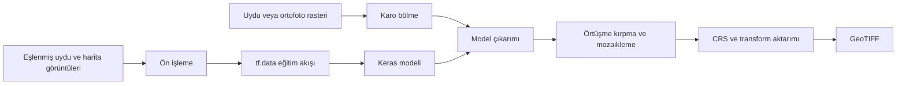

# Uydu Görüntüsünden Harita Üretimi

Otoenkoder tabanlı görüntü-görüntü dönüşümü, karo tabanlı büyük raster işleme ve
GeoTIFF çıktı üretimi için geliştirilen akademik araştırma yazılımı.

> **Proje durumu:** Araştırma prototipi. Kod, veri hazırlama, model eğitimi ve
> çıkarım iş akışını destekler; ancak bu depoda yayımlanmış bir veri kümesi,
> eğitilmiş model ağırlığı veya nihai başarı tablosu bulunmamaktadır.

**Hızlı erişim:** [Yöntem](#yöntem-ve-iş-akışı) · [Kurulum](#kurulum) ·
[Kullanım](#kullanım) · [Çıktılar](#çıktı-yapısı) ·
[Yeniden üretilebilirlik](#deney-tasarımı-ve-yeniden-üretilebilirlik) ·
[Değerlendirme](#değerlendirme) · [Atıf](#atıf)

## Özet

Bu proje, uydu veya ortofoto görüntülerini kartografik rasterlara ya da nesne
maskelerine dönüştürmek için denetimli derin öğrenme yaklaşımlarını araştırır.
Büyük giriş rasteri önce örtüşen karolara ayrılır. Karolar eğitilmiş bir Keras
modeliyle işlenir, tek bir mozaik hâlinde birleştirilir ve uygun bir mekânsal
referans mevcutsa GeoTIFF olarak kaydedilir.

Çalışmanın güncel uygulaması dört bileşenden oluşur:

1. Yan yana eşlenmiş görüntülerden eğitim verisi veya maske hazırlama.
2. Yapılandırılabilir otoenkoder/U-Net türevlerinin eğitimi.
3. Büyük rasterlarda karo tabanlı toplu çıkarım ve mozaikleme.
4. Kaynak ya da referans rasterdan CRS ve dönüşüm bilgisinin aktarılması.

**Anahtar kelimeler:** uzaktan algılama, uydu görüntüsü, görüntü-görüntü
dönüşümü, otoenkoder, U-Net, kartografik genelleştirme, GeoTIFF.

### English abstract

This research software investigates supervised image-to-image translation from
satellite or orthophoto imagery to cartographic rasters and object masks. Large
rasters are divided into overlapping tiles, processed in batches with a trained
Keras model, reconstructed as a lossless mosaic, and exported as a
georeferenced GeoTIFF when a valid spatial reference is available. The
repository provides data-preparation, training, inference, mosaicking, and
georeferencing code. It does not currently distribute a dataset, trained
weights, or peer-reviewed benchmark results.

## Araştırma Amacı

Temel araştırma sorusu, yüksek çözünürlüklü uydu/ortofoto verisindeki mekânsal
örüntülerin, piksel düzeyinde kartografik bir gösterime ne ölçüde
dönüştürülebildiğidir. Depo aşağıdaki deneyleri destekleyecek şekilde
tasarlanmıştır:

- gri tonlu, RGB veya farklı giriş/çıkış kanal kombinasyonları;
- standart otoenkoderler ile residual U-Net türevlerinin karşılaştırılması;
- L1, SSIM ve ağırlıklı hibrit kayıp fonksiyonları;
- boş ya da bilgi içermeyen hedef karoların filtrelenmesi;
- farklı karo örtüşmesi, normalizasyon ve görüntü iyileştirme ayarları;
- model çıktısının kayıpsız mozaiklenmesi ve mekânsal referansının korunması.

Kod belirli bir bölgeye sabitlenmemiştir. Bununla birlikte otomatik referans
eşleştirme sözlüğü şu anda Kapadokya çevresinde kullanılan bazı yer adlarını
içerir. Yeni çalışma alanları için `CONFIG["reference"]["auto_match_keywords"]`
listesi genişletilmeli veya referans raster açıkça belirtilmelidir.

## Yöntem ve İş Akışı



### 1. Veri hazırlama

Eğitim örnekleri tek bir görüntü içinde yatay olarak eşlenmiş olmalıdır:

```text
+----------------------+----------------------+
| sol: uydu/ortofoto   | sağ: hedef harita    |
+----------------------+----------------------+
```

`egitim/harita_maske_onisleme.py`, sağ yarıdaki harita bilgisinden siyah nesne
maskesi üretebilir. `paired` modu uydu ve maskeyi yeniden yan yana kaydeder;
`mask` modu yalnızca maskeyi kaydeder. Varsayılan ayarlar uydu tarafında
tekrarlanabilir (`seed=42`) ışık, renk, gölge, gürültü ve bulanıklık
çeşitlemeleri de üretebilir.

### 2. Eğitim

`egitim/autoencoder_unified.py`, eşlenmiş görüntüyü çalışma anında ikiye ayırır,
girdi ile hedefi `[-1, 1]` aralığına normalize eder ve bir `tf.data` veri hattı
üzerinden modele verir. Güncel varsayılanlar arasındaki başlıca değerler:

| Ayar | Varsayılan değer |
|---|---:|
| Görüntü boyutu | `544 x 544` |
| Giriş modu | `grayscale` |
| Çıkış modu | `grayscale` |
| Model | `classic` |
| Çıkış aktivasyonu | `tanh` |
| Eğitim/doğrulama oranı | `0.90 / 0.10` |
| Rastgelelik tohumu | `42` |
| Batch boyutu | `8` |
| Epoch | `20` |
| Optimizasyon | Adam, `1e-3` |
| Kayıp | `weighted_hybrid` |

Eğitim yapılandırması bir CLI yerine dosyanın başındaki `Config` sınıfından
yönetilir. Desteklenen model seçenekleri `unet_residual`, `autoencoder`,
`autoencoder_backup`, `upsampled`, `advanced`, `gpt`, `gpt_no_reg`, `deneysel`,
`classic` ve `flat_bottleneck` değerleridir. Kod içi yorumlar, `flat_bottleneck`
mimarisini iç bir kıyaslamada `success_25m = 0.70` değerine ulaşan sığ mimari
sınıfı olarak tanımlar; bu değer bu depoda bağımsız olarak yeniden üretilmemiş
veya belgelenmemiştir ve atıfta bulunulmadan önce yeniden doğrulanmalıdır.

`OUTPUT_ACTIVATION` (`tanh` veya `sigmoid`), eğitim etiketlerinin
normalize edilmesi gereken değer aralığını sabitler: `tanh` etiketlerin
`[-1, 1]` aralığında olmasını, `sigmoid` ise `[0, 1]` aralığında olmasını
bekler. `validate_activation_contract()`, aktivasyon ile etiket aralığı
uyuşmadığında hatayı erken verir; ancak bu yalnızca eğitim zamanı kontrolüdür
— çıkarım için karşılık gelen girdi normalizasyonu yine de elle ayarlanmalıdır
(bkz. [Karo tabanlı çıkarım](#3-karo-tabanlı-çıkarım)).

#### Kanal stratejileri

Giriş ve hedef kanal sayıları birbirinden bağımsız ayarlanabilir:

| `COLOR_MODE` | `OUTPUT_COLOR_MODE` | Kullanım |
|---|---|---|
| `grayscale` | `grayscale` | Tek kanallı uydu görüntüsünden tek kanallı harita/maske |
| `rgb` | `rgb` | Renkli uydu görüntüsünden renkli kartografik raster |
| `rgb` | `grayscale` | Renkli uydu görüntüsünden tek kanallı harita/maske |
| herhangi biri | `auto` | Çıkış kanalını giriş kanalıyla aynı tutma |

Kanal stratejisi değiştirildiğinde modelin giriş/çıkış şekli, eğitim verisi ve
çıkarım ayarı birlikte değiştirilmelidir. Eğitim ve çıkarım arasında kanal veya
normalizasyon uyuşmazlığı, model dosyası başarıyla yüklense bile anlamsız çıktı
üretebilir.

#### Amaç fonksiyonu

Varsayılan `weighted_hybrid` kaybı, ağırlıklı mutlak hatayı yapısal benzerlik
kaybıyla birleştirir:

```text
L = 0.8 * [sum_i(w_i * |y_i - y_hat_i|) / sum_i(w_i)]
    + 0.2 * [1 - SSIM(y, y_hat)]
```

Varsayılan piksel ağırlıkları açık arka plan için `1`, beyaz olmayan içerik için
`2`, koyu ayrıntılar için `8` değeridir. Amaç, açık arka planın baskın olduğu
hedeflerde yol, sınır ve yapı gibi koyu ayrıntıların kayıp içindeki etkisini
artırmaktır. Bu ağırlıklar veri kümesinden öğrenilmez; deneysel hiperparametre
olarak raporlanmalı ve ablasyonla sınanmalıdır.

### 3. Karo tabanlı çıkarım

Güncel varsayılanlarda `tile_size=544`, `overlap=32` ve dolayısıyla
`frame_size=512` kullanılır. Birleşim sırasında her kenardan
`crop_overlap=16` piksel kırpılır. Temel tutarlılık koşulları:

```text
frame_size = tile_size - overlap
crop_overlap = overlap / 2
tile_size = modelin beklediği uzamsal girdi boyutu
```

Karolar PNG olarak kaydedilir. Model kanalı `auto` modunda modelin girdi
şekline bakılarak belirlenir. Çıkarım normalizasyonu, modelin eğitimde kullandığı
normalizasyonla aynı olmalıdır; bu projede eğitilen modeller için varsayılan
`minus1_1` seçeneğidir.

Başlıca çıkarım seçenekleri:

| Parametre | Seçenekler | Açıklama |
|---|---|---|
| `color_mode` | `auto`, `grayscale`, `rgb` | Model giriş kanalını belirler |
| Normalizasyon | `minus1_1`, `zero_1`, `raw`, `zscore` | Girdi değer aralığını eğitimle eşler |
| İyileştirme | `none`, `hist_eq`, `clahe` | Normalizasyondan önce kontrast işlemi uygular |
| `batch_size` | pozitif tam sayı | Hız ile GPU/RAM tüketimini dengeler |
| Karo biçimi | PNG | Ara çıktıda kayıplı sıkıştırmayı önler |

Normalizasyon ve görüntü iyileştirme seçeneklerinin tamamı programatik API ve
grafik arayüzde kullanılabilir. CLI, `color_mode` için varsayılan `auto`
değerini kullanır; CLI üzerinden açık seçim yapılacaksa mevcut seçenekler
`grayscale` ve `rgb` ile sınırlıdır.

### 4. Jeoreferanslama

Pipeline mekânsal bilgiyi şu öncelik sırası ile belirler:

1. Kullanıcı tarafından verilen referans GeoTIFF.
2. Dosya adına göre güvenli biçimde eşleşen referans raster.
3. Coğrafi referanslıysa giriş GeoTIFF'in kendi CRS ve transform bilgisi.

Bu kaynakların hiçbiri yoksa mozaik üretilir, fakat jeoreferanslama atlanır.
Ayrı bir referans kullanıldığında raster kapsamı, piksel boyutu, CRS ve veri
hizalamasının kullanıcı tarafından doğrulanması gerekir.

## Depo Yapısı

```text
autoencoder_sat_to_map/
|-- src/
|   |-- goruntu_islemleri.py       # CLI ve temel işleme sınıfı
|   `-- harita_uretici_arayuz.py   # Gradio arayüzü
|-- egitim/
|   |-- autoencoder_unified.py     # Güncel eğitim uygulaması
|   |-- harita_maske_onisleme.py   # Maske ve eşlenmiş veri üretimi
|   `-- autoencoder_...py          # Önceki etkin eğitim varyantı
|-- arsiv/                         # Tarihsel deneyler; ana akış değil
|-- ciktilar/                      # Pipeline çalışma klasörleri
|-- ana_haritalar/                 # Eski/manuel mozaik çıktıları
|-- georefli/                      # Eski/manuel GeoTIFF çıktıları
`-- README.md
```

`arsiv/` altındaki betikler deney geçmişini korumak amacıyla tutulur. Yeni
çalışmalarda `src/goruntu_islemleri.py`, `src/harita_uretici_arayuz.py` ve
`egitim/autoencoder_unified.py` esas alınmalıdır.

## Kurulum

### Gereksinimler

- Python 3.10 önerilir.
- Model eğitimi/çıkarımı için TensorFlow 2.x.
- GeoTIFF işlemleri için Rasterio ve GDAL uyumlu sistem kütüphaneleri.
- GPU kullanılacaksa TensorFlow, CUDA, cuDNN ve ekran kartı sürücüsü birbirleriyle
  uyumlu olmalıdır.

Depoda henüz sabitlenmiş bir `requirements.txt` veya `environment.yml`
bulunmadığından, aşağıdaki kurulum bir başlangıç ortamıdır; yayımlanacak
deneylerde tam paket sürümleri ayrıca kaydedilmelidir.

```powershell
conda create -n sat2map python=3.10 -y
conda activate sat2map
conda install -c conda-forge numpy opencv matplotlib natsort tqdm rasterio affine -y
pip install tensorflow gradio
```

Histogram eşitlemeli eğitim modu kullanılacaksa TensorFlow sürümüyle uyumlu bir
`tensorflow-addons` kurulumu da gerekir:

```powershell
pip install tensorflow-addons
```

Kurulumu kaydetmek için:

```powershell
python --version
python -m pip freeze > environment-lock.txt
```

`environment-lock.txt` yerel deney kaydıdır; mevcut `.gitignore` yapısı
nedeniyle depoya otomatik olarak eklenmeyebilir.

## Kullanım

Tüm komutlar depo kök dizininden çalıştırılmalıdır.

### Grafik arayüz

```powershell
python src/harita_uretici_arayuz.py
```

Arayüz; girdi rasteri, model, referans raster, karo boyutu, örtüşme,
normalizasyon, görüntü iyileştirme (histogram eşitleme veya CLAHE) ve batch
boyutunun seçilmesini sağlar. Çalışma günlüğü ile üretilen mozaik ve GeoTIFF
dosyaları aynı arayüzden izlenebilir.

### Tek modelle tam pipeline

```powershell
python src/goruntu_islemleri.py pipeline `
  --input "veri/girdi.tif" `
  --model_dir "modeller/tek_model" `
  --reference "veri/girdi.tif" `
  --run_name "deney_001"
```

Bu örnekte `modeller/tek_model/` dizini yalnızca çalıştırılacak `.h5` veya
`.keras` dosyasını içermelidir. Geçerli bir `--model_dir` varsa uygulama bu
dizini `--model_path` seçeneğinden önce işler. `--reference` verilmezse otomatik
referans seçimi ve ardından giriş GeoTIFF'in kendi mekânsal bilgisi denenir.

### Bir dizindeki tüm modellerle çıkarım

```powershell
python src/goruntu_islemleri.py pipeline `
  --input "veri/girdi.tif" `
  --model_dir "modeller" `
  --output_root "ciktilar" `
  --batch_size 8
```

### Adımları ayrı çalıştırma

```powershell
# Karo üretimi
python src/goruntu_islemleri.py split `
  --input "veri/girdi.tif" `
  --output_dir "calisma/karolar" `
  --tile_size 544 `
  --overlap 32 `
  --format png `
  --save_metadata

# Metadata ile mozaikleme
python src/goruntu_islemleri.py merge `
  --input_dir "calisma/karolar" `
  --output "calisma/mozaik.png"

# Mozaiği GeoTIFF'e dönüştürme
python src/goruntu_islemleri.py georef `
  --input "calisma/mozaik.png" `
  --reference "veri/referans.tif" `
  --output "calisma/mozaik_geo.tif" `
  --compress LZW
```

Tüm CLI seçenekleri:

```powershell
python src/goruntu_islemleri.py --help
python src/goruntu_islemleri.py split --help
python src/goruntu_islemleri.py pipeline --help
python src/goruntu_islemleri.py merge --help
python src/goruntu_islemleri.py georef --help
```

### Maske ve eşlenmiş eğitim verisi üretimi

```powershell
python egitim/harita_maske_onisleme.py `
  --input_dir "ham_veri" `
  --output_dir "training_set" `
  --mode paired `
  --mask_profile balanced `
  --save_preview 10
```

`strict` profil daha düşük yanlış-pozitif oranı hedefleyen daha katı morfolojik
eşikler kullanır. Bu ön işleme, klasik görüntü işleme eşiklerine dayalıdır;
farklı harita stilleri ve renk paletleri için görsel kontrol ve parametre
kalibrasyonu gerekir.

### Model eğitimi

1. `egitim/autoencoder_unified.py` içindeki `Config.DATA_DIR`, kanal modu, model,
   kayıp fonksiyonu ve eğitim hiperparametrelerini deney protokolüne göre ayarlayın.
2. Eşlenmiş görüntülerin sol yarıda girdi, sağ yarıda hedef içerdiğini doğrulayın.
3. Eğitimi başlatın:

```powershell
python egitim/autoencoder_unified.py
```

Her epoch için checkpoint ve eğitim sonunda `son_model.h5` üretilir. Var olan
bir modeli devam ettirmek için `Config.PRETRAINED_MODEL` açıkça ayarlanmalıdır.

## Asgari Yeniden Üretilebilir Deney

Bir deneyi yalnızca çalıştırmak değil, sonradan denetlenebilir kılmak için şu
asgari kayıt akışı önerilir:

```powershell
# 1. Kod sürümünü kaydet
git rev-parse HEAD

# 2. Ortamı kaydet
python --version
python -m pip freeze > environment-lock.txt

# 3. Benzersiz adla çıkarımı çalıştır
python src/goruntu_islemleri.py pipeline `
  --input "veri/test_bolge_01.tif" `
  --model_dir "modeller/deney_001" `
  --reference "veri/test_bolge_01.tif" `
  --run_name "deney_001_test_bolge_01"
```

Çalışma tamamlandıktan sonra şu kontroller yapılmalıdır:

1. `run_manifest.json` içindeki girdi, model ve çıktı yolları doğru mu?
2. `pipeline.log` içinde hata, atlanan karo veya başarısız model var mı?
3. `metadata.json` içindeki karo sayısı ile model çıktı sayısı eşit mi?
4. Mozaikte boşluk, tekrar veya dikiş artefaktı var mı?
5. GeoTIFF CRS'i, sınırları ve piksel boyutu kaynak rasterla uyumlu mu?
6. Nicel değerlendirme yalnızca daha önce görülmemiş coğrafi test alanında mı
   hesaplandı?

### Sık karşılaşılan sorunlar

| Belirti | Kontrol/çözüm |
|---|---|
| Rasterio veya GDAL kurulumu başarısız | Aynı ortamda `conda-forge` paketlerini kullanın; `pip` ve Conda GDAL kurulumlarını gelişigüzel karıştırmayın. |
| Model yüklenemiyor | TensorFlow/Keras sürümünü, `.h5` için HDF5 desteğini ve özel kayıp fonksiyonlarını kontrol edin. Pipeline bazı eski `Conv2DTranspose` yapılandırmaları için uyumluluk katmanı içerir. |
| Çıktı tamamen açık, koyu veya bozuk | Eğitimdeki kanal modu, `tile_size`, normalizasyon ve çıktı aktivasyonunu çıkarım ayarlarıyla karşılaştırın. |
| Renkler ters görünüyor | OpenCV'nin BGR, model hattının RGB kullandığını doğrulayın; araya eklenen özel ön işleme kodunu denetleyin. |
| Karo birleşimi kaymış veya dikişli | `metadata.json` dosyasını koruyun ve `crop_overlap = overlap / 2` koşulunu doğrulayın. |
| GPU belleği yetersiz | Önce `batch_size` değerini düşürün; bilimsel kapsamı veya karo örneklerini azaltmadan tekrar çalıştırın. |
| GeoTIFF yanlış konumda | Referans rasterin doğru bölgeye, CRS'e, kapsama ve çözünürlüğe ait olduğunu bağımsız olarak doğrulayın. |

## Çıktı Yapısı

Varsayılan tam pipeline, önceki sonuçları ezmemek için zaman damgalı bir çalışma
dizinini oluşturur:

```text
ciktilar/<girdi_adi>/run_YYYYMMDD_HHMMSS/
|-- 01_crops/
|   |-- goruntu_<satir>_<sutun>.png
|   `-- metadata.json
|-- 02_model/<model_adi>/
|   |-- goruntu_<satir>_<sutun>.png
|   `-- metadata.json
|-- 03_merged/
|   `-- ana_harita_<girdi>_<model>.png
|-- 04_georef/
|   `-- ana_harita_<girdi>_<model>_geo.tif
|-- pipeline.log
`-- run_manifest.json
```

`metadata.json` karo ızgara bilgilerini; `pipeline.log` işlem günlüğünü;
`run_manifest.json` ise girdi, model, referans ve üretilen dosya yollarını
kaydeder. Akademik arşivlemede bu üç dosya model ağırlığı ve ortam dökümüyle
birlikte korunmalıdır.

## Deney Tasarımı ve Yeniden Üretilebilirlik

Yayımlanabilir bir deney için en az aşağıdaki bilgiler raporlanmalıdır:

- depo commit kimliği (`git rev-parse HEAD`) ve Python/paket sürümleri;
- veri kaynağı, lisansı, tarih aralığı, coğrafi kapsam ve yer örnekleme mesafesi;
- eğitim, doğrulama ve test bölgelerinin dosya listeleri;
- model tipi, giriş/çıkış kanalları, normalizasyon, kayıp ve tüm hiperparametreler;
- `tile_size`, `overlap`, `crop_overlap`, batch boyutu ve çıkarım donanımı;
- referans rasterin CRS'i, transformu ve çıktının mekânsal kapsam kontrolü;
- rastgelelik tohumları, checkpoint seçim ölçütü ve durdurma kuralı;
- nicel metrikler ile nitel hata örnekleri.

Güncel eğitim kodu dosyaları `seed=42` ile karıştırıp rastgele yüzde 90/10
bölmektedir. Komşu karolar aynı sahneden geldiği için bu yöntem mekânsal veri
sızıntısına ve iyimser doğrulama sonucuna yol açabilir. Nihai deneylerde eğitim,
doğrulama ve test kümeleri dosya bazında değil, birbirinden ayrık coğrafi bloklar
veya bölgeler bazında oluşturulmalıdır.

TensorFlow için yalnızca NumPy tohumu ayarlanması tam deterministik çalışma
garantisi vermez. Kesin yeniden üretim gerekiyorsa Python, NumPy ve TensorFlow
tohumları birlikte sabitlenmeli, uygun deterministik işlem seçenekleri
etkinleştirilmeli ve GPU/yazılım sürümleri raporlanmalıdır.

## Değerlendirme

Depoda şu anda otomatik bir test veya benchmark modülü bulunmamaktadır. Bu
nedenle README herhangi bir modelin bilimsel olarak daha iyi olduğunu ya da
belirli bir başarı düzeyine ulaştığını iddia etmez.

Amaca göre önerilen raporlama seti:

| Çıktı türü | Nicel ölçütler | Ek kontrol |
|---|---|---|
| Sürekli/kartografik raster | MAE, RMSE, SSIM, PSNR | Kenar ve ince çizgi korunumu |
| İkili nesne maskesi | Precision, recall, F1, IoU | Nesne boyutuna göre hata |
| Jeoreferanslı sonuç | metre cinsinden konum hatası | CRS, kapsam ve piksel boyutu |
| Sistem performansı | karo/s, toplam süre, tepe bellek | CPU/GPU ve batch bilgisi |

Metrikler görüntü ortalaması yanında sahne/bölge bazında da verilmeli; merkezi
eğilimle birlikte dağılım, güven aralığı ve aykırı örnekler raporlanmalıdır.

### Sonuç tablosu şablonu

README'ye veya bir makalenin ek materyaline sonuç eklenirken boş ya da
doğrulanmamış hücreler başarı iddiasıyla doldurulmamalıdır. Aşağıdaki yapı,
modellerin aynı test protokolü altında karşılaştırılmasını sağlar:

| Deney | Eğitim bölgeleri | Test bölgesi | Model | Girdi/çıktı | SSIM veya IoU | MAE veya F1 | Süre (s) | Not |
|---|---|---|---|---|---:|---:|---:|---|
| `exp_001` | `<bölgeler>` | `<ayrık bölge>` | `<model>` | `1→1` | `<değer>` | `<değer>` | `<değer>` | `<donanım>` |

Her tabloyla birlikte test örneği sayısı, metrik yönü, hesaplama ölçeği,
checkpoint seçim kuralı ve kullanılan commit kimliği verilmelidir.

## Bilinen Sınırlılıklar

- Veri kümesi ve eğitilmiş modeller bu depoya dâhil değildir; ayrıca temin
  edilmeleri gerekir.
- Bağımlılık sürümleri henüz kilitlenmemiştir.
- Eğitim yapılandırması CLI veya deney YAML'i yerine Python sınıfı içindedir.
- Varsayılan eğitim/doğrulama bölmesi mekânsal bloklamalı değildir.
- Otomatik referans seçimi dosya adı anahtar kelimelerine dayanır.
- Jeoreferanslama semantik veya geometrik kayıt hatasını otomatik ölçmez.
- Arayüzde durdurma, çalışan görevi iptal eder; kısmi çıktıların tamlığı ayrıca
  kontrol edilmelidir.
- Araştırma kodu için birim ve entegrasyon testleri henüz eklenmemiştir.

## Veri, Etik ve Kullanım Koşulları

Uydu, ortofoto ve çevrim içi harita verileri farklı telif, lisans, atıf ve
yeniden dağıtım koşullarına tabi olabilir. Kullanıcı, veri sağlayıcısının
koşullarını incelemekten; eğitim ve türetilmiş çıktıların paylaşım hakkını
doğrulamaktan; hassas konum veya kişisel veri riski varsa uygun önlemleri
almaktan sorumludur.

Üretilen haritalar insan denetimi olmadan navigasyon, afet yönetimi, kadastro,
güvenlik veya diğer yüksek riskli operasyonel kararlarda kullanılmamalıdır.

## Atıf

Bu depo için henüz bir `CITATION.cff`, DOI veya yayına ait kesin bibliyografik
kayıt bulunmamaktadır. Akademik kullanımda en azından depo adresi ve kullanılan
commit kimliği belirtilmelidir:

```text
autoencoder_sat_to_map. Uydu görüntüsünden harita üretimi araştırma yazılımı.
https://github.com/elestirmen/autoencoder_sat_to_map, erişim tarihi: YYYY-AA-GG,
commit: <git rev-parse HEAD çıktısı>.
```

Bir makale veya veri yayınıyla eşleşecek resmî atıf bilgisi eklendiğinde bu
bölüm güncellenmelidir.

## Lisans

Bu proje MIT Lisansı ve Apache Lisansı 2.0 altında çift lisanslıdır.

## Katkı

Hata bildirimleri ve katkılar GitHub issue veya pull request üzerinden
iletilebilir. Bilimsel davranışı değiştiren katkıların veri bölme protokolü,
parametreler, beklenen çıktı ve doğrulama kanıtıyla birlikte sunulması önerilir.
